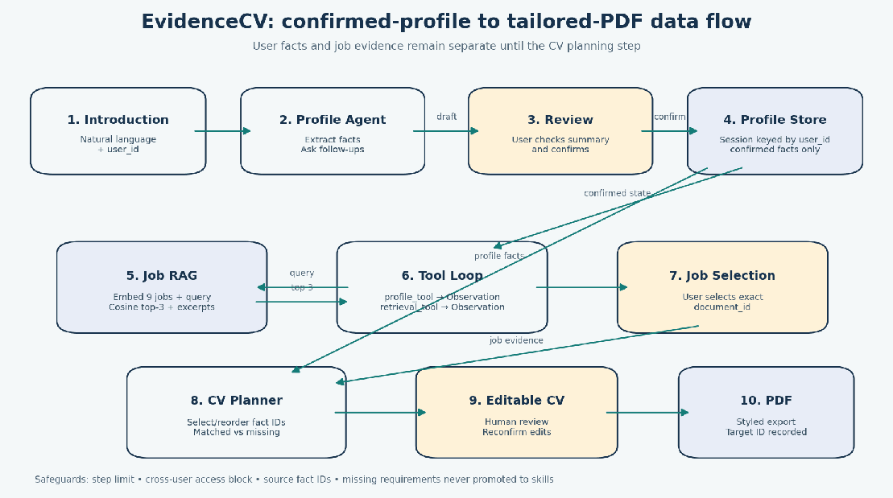

# EvidenceCV: AI-Powered CV Builder

A Streamlit app that turns a short self-introduction into a confirmed profile, retrieves the three best-matching jobs with embeddings (RAG), and generates a tailored, editable CV exported as PDF. A tool-calling agent drives the workflow, and every line on the CV traces back to a fact the user confirmed: the model chooses *which* facts to emphasise, never invents new ones.

Built for 43007 Advanced Artificial Intelligence at UTS.



## Highlights
- **Agent with tools:** a bounded tool-calling loop (`profile_tool`, `retrieval_tool`) with every Action and Observation shown in the UI.
- **RAG job matching:** nine job listings embedded with `text-embedding-3-small`, ranked by cosine similarity, with supporting excerpts.
- **Grounded CVs:** three separate objects (confirmed profile, job record, CV document). Missing job requirements are shown as gaps and never added to the CV.
- **Follow-up questions:** the agent asks for missing details one at a time before the profile is confirmed.
- **User isolation:** profiles are session-scoped per user, and changing the target job never alters the confirmed profile.
- **Offline mode:** without an API key, a deterministic parser and TF-IDF index exercise the same code paths, so the tests run without credentials.

## Results
- **12 of 12 tests pass** (data integrity, retrieval, follow-ups, user isolation, agent trace, grounding, CV differences, PDF validity).
- **5 of 5 test profiles** got their expected job in the top three ([results](evidence/03_Evidence/04_System_Tests/five_profile_results.md)).
- Sample CVs are regenerated by `python scripts/run_evaluation.py`. More evidence: [`evidence/`](evidence/03_Evidence).

## Run it
```bash
python -m venv .venv
source .venv/bin/activate        # Windows: .venv\Scripts\Activate.ps1
pip install -r requirements.txt
cp config.example .env           # add your OpenAI key for live mode (optional)
streamlit run app.py
```
Tests and evaluation:
```bash
python -m pytest
python scripts/run_evaluation.py
```

## Project layout
| Path | Purpose |
|---|---|
| `app.py` | Streamlit UI and the profile-to-PDF workflow |
| `src/profile_builder.py` | Fact extraction, completeness checks, follow-up questions |
| `src/agent.py` | Tool schemas, bounded agent loop, Actions/Observations |
| `src/retrieval.py` | Embedding index, cosine ranking, excerpts |
| `src/matching.py` | Matched evidence and missing requirements |
| `src/cv_generator.py` | Evidence-constrained CV planning and grounding checks |
| `src/pdf_export.py` | Styled PDF export |
| `data/` | Job listings and **synthetic** student profiles (no real people) |

## Limitations
- Similarity scores are relevance evidence, not hiring recommendations.
- Keyword-based gap analysis can miss synonyms.
- Session memory only: no accounts or persistent storage.

## Tech
Python, Streamlit, OpenAI Responses API (function calling), OpenAI embeddings, scikit-learn, Pydantic, ReportLab, pytest.
